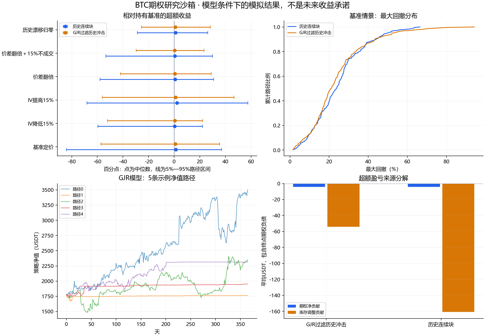

# 冻结的V1模拟样例

这是2026-11-03发布的小时级研究运行，不是真实账户业绩，也不是未来收益预测。

- 初始示例：0.01BTC＋1,000USDT，现价固定为77,928.48USDT；0.09BTC核心仓排除。
- 两种价格模型，各256条365天路径；六种情景，共3,072条策略结果。同一市场的情景复用冲击，不能当作3,072个独立样本。
- 数值失败0；库存与Call覆盖违规0；4条情景路径出现现金储备不足风险，已计入风险退出。
- 26项离线测试通过；源码移植后重跑年度实验，逐路径数值与原研究一致。

**结果尚未证明V1具有稳定超额收益。** GJR基准情景相对持有相同BTC和现金的平均超额收益为-3.30个百分点，模型内抽样区间约[-7.57,+0.73]个百分点。总收益含BTC价格变化，不能解释为期权权利金收益。

价格留出诊断：GJR有12/13项相容，周尺度波动依赖仍不匹配；连续历史块只有8/13项相容，未达到探索性门槛。未通过的模型结果保留，不宣称仿真已经等同真实市场。

- [完整报告与假设](REPORT.md)
- [完整机器结果](results.json)
- [逐路径模拟记录](path-results.csv)
- [情景统计](scenario-summary.csv)
- [模型诊断](model-validation.json)
- [极端注入测试](tail-stress.json)
- [种子、运行环境及源码/数据哈希](run-manifest.json)
- [发布验证记录](verification.json)

复现步骤见[主README](../../README.md)。原始现货与期权ZIP不随仓库提交，可通过公开下载脚本获取并核对官方SHA256。结果图使用Windows中文字体，其他系统可能需要配置中文字体。

