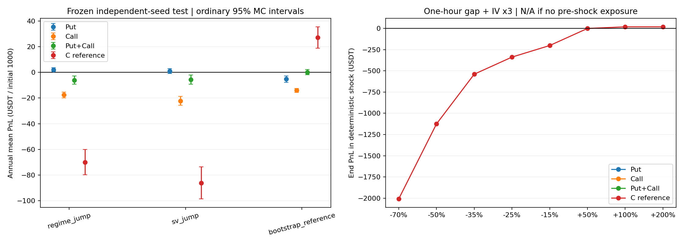

# Put / Call / 双卖：新随机市场研究结果

本轮冻结有限候选、修复账户与执行后完成比较。全部数值是模型条件下的模拟证据，不是实际成交回报或未来保证。

## 随机市场检验

两个主发生器用新Gaussian/Poisson/双指数冲击，历史只估计参数；历史重采样另列对照。参数不按策略盈亏校准。

|模型|平均标准化市场距离|研究门槛|随机性检查|
|---|---:|---|---|
|regime_jump|1.217|未通过|见随包详细诊断|
|sv_jump|1.278|未通过|见随包详细诊断|
|bootstrap_reference|0.997|未通过|见随包详细诊断|

门槛只用于研究筛选；即使通过也不能证明未来市场等价。2024只有四个不重叠90天窗口，而且用于模型结构选择；2025–2026以前已看过。

## 策略测试

217组有限候选；搜索24条90天路径/模型，验证128条年度路径/模型，每方向冻结一名，再用512条年度路径/模型测试。三种方向资金、数量和成交约束一致。

|方向|候选期限/Delta|止盈/止损|入场|验证及最终均通过的模型内候选|
|---|---|---|---|---|
|Put|7d / 0.05|70% / 2倍|3%方向化逆向|否|
|Call|14d / 0.05|70% / 2倍|3%方向化逆向|否|
|Put+Call|7d / 0.20|70% / 2倍|3%方向化逆向|否|

下表是基础情景的平均年度净盈亏USDT，分母均为初始1000USDT；失败诊断候选也保留，不能把其行解读成推荐。

|方向/对照|regime_jump|sv_jump|bootstrap_reference|最差情景同时95%下界|
|---|---:|---:|---:|---:|
|Put|1.99|1.03|-5.26|-1.84%|
|Call|-17.54|-22.20|-14.03|-3.68%|
|Put+Call|-6.04|-5.61|0.16|-2.99%|
|C固定数量对照|-70.04|-86.13|27.23|-26.98%|

|方向/对照|最差CVaR5|最高回撤95分位|单情景最多强平路径/512|最低平均年成交腿数|最高零成交比例|
|---|---:|---:|---:|---:|---:|
|Put|-10.99%|11.78%|0|18.91|0.00%|
|Call|-19.97%|11.42%|0|20.08|0.20%|
|Put+Call|-13.98%|10.96%|0|5.61|8.59%|
|C固定数量对照|-57.54%|52.02%|0|140.10|0.00%|

模型内选择：**现金基准（未发现满足预声明条件的卖方候选）**。实际市场适配与执行证据仍不足，不自动推广实盘。

零观察事件不等于零风险：每情景512条独立路径，零次强平时单侧95%模型条件概率上界约0.58%。不同情景共用路径，不能相加成独立样本。

## 本轮修复与限制

固定每腿0.01BTC、最多四腿；双卖成对进入；修正AE、95%强平阈值、平仓后MM重算和IM预算；盘中高低点风险先于普通止损，旧限价和新单成交均保持因果；期末负债/费用完整计入。

OHLC取不利顺序属于保守压力近似，不是覆盖所有真实路径的严格损失上界；协调双腿和全部最小数量成交的假设未获真实盘口验证；行权仍用小时结算代理。止损不能限制跳空最大损失，Call空头理论损失无上限。

当前一次SSVI截面、2023 IV动态、未来偏斜和真实成交缺少按时间留出的验证。新随机过程避免只复制历史，并不自动消除模型偏差。

确定性跳空表见deterministic-gap-stress.csv：只对给定冲击展示损益，没有为极端冲击捏造发生概率。若注入前没有持仓，图中标为缺失、不与已持仓策略比较，不能将未暴露的零损失解释为安全。完整协议和候选均冻结，最终测试后不再调参追逐盈利。
