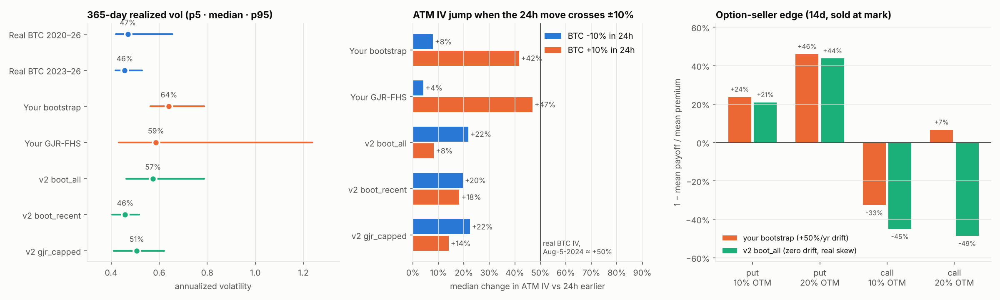
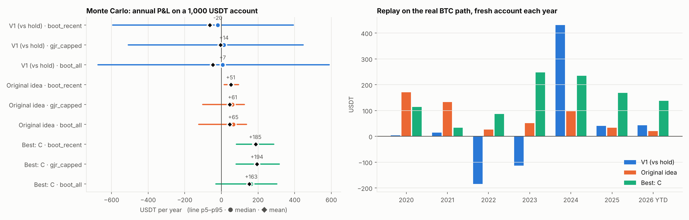

> 2026-11-05 review notice: this is a historical, pre-fix research report. Its margin equity/threshold, fixed-lot wording, no-liquidation claim and hourly risk implementation require correction. The displayed returns are model-conditional and do not establish an executable optimal strategy. See the [corrected stochastic-market study](../frontier/README.md) and its [frozen results](../frontier/examples/2026-11-05/RESULT.md).

# Roasting the BTC option-selling strategy and its Monte Carlo generator

Date: 2026-11-02. Scope: `research/options_sandbox` (V1 "covered-inventory" strategy and its Monte Carlo
generator) and the original idea in `币安BTC期权交易模型.md` (sell 1–2 month puts 20–30% OTM after a ~5% drop
and hold to expiry). Everything here is offline research. It uses no account access, API keys or orders.

## TL;DR

1. **The generator is well-engineered but not good enough for this job.** It reproduces exactly and its accounting
   is careful, but the answer it gives is set by its assumptions. The base case is a +50%/yr bull market; the IV model
   is a 5-month 2023 regression that spikes IV in rallies instead of crashes; GJR occasionally simulates 17–21× one-hour
   moves; the IV noise mean-reverts within hours, so any "sell rich IV" rule looks like free money; and the
   bootstrap's "zero drift" is really −8.4%/yr. Ten problems in total (section 1). I built a v2 calibrated to real data
   only: real prices 2020–26, the real 2023 Binance IV series reconstructed from your own files, and the real
   2026-10-15 Binance chain (section 2).
2. **V1 loses to "just hold" in all 27 calibrated worlds.** Its option legs make −8 to +14 USDT a year, and its call
   leg is a donation under the real put skew. Its spot conversions are a hidden BTC bet worth −230 to +5 a year.
   Even in your own generator its option legs lose money in all four base/zero-drift cases.
3. **Your original idea** (45-day 25%-OTM put after a −5% day) averages +42–51 USDT/yr. Within your own
   "20–30% OTM, 1–2 months" range, though, March 2020 ranges from +126 to −564 USDT (force-liquidated).
4. **Best strategy found ("C"):** every day sell one 0.01 BTC weekly put at ~0.08Δ (≈ 8% OTM), hold at most 4,
   take profit at 90%, **stop at 2× premium**, never sell calls, never trade spot. **Expected +153 / +187 / +195 USDT
   per year on 1,000 USDT** in the three base worlds. Its mean is never negative in any of 57 stress worlds
   (worst +65). On the real 2020–2026 path, with expiries on real Fridays 08:00 UTC, it makes **+1,409 USDT with no
   losing year**. The main risk is a single-hour gap; the number of lots is the dial (section 5).
5. **It follows Binance's option rules** (section 5b). Everything is USDT: premium, margin, buy-backs and cash
   settlement. No BTC is ever delivered or needed. Sparse real strike grids cost it only 2–7% of its profit. The 2×
   stop needs your own bot, because I couldn't confirm that Binance options support stop orders.

---

## 0. Data and reproduction

- `data.binance.vision`, `api.binance.com`, `eapi.binance.com` and `www.deribit.com` are blocked by this session's
  network policy. I rebuilt `data/btc_spot_1h.csv` (2020-01-01 → 2026-10-24 23:00 UTC) from a public GitHub mirror of
  Binance spot BTCUSDT **1-minute** klines, aggregated to 1h (`roast/build_hourly.py` is the exact aggregation).
  Three independent checks against data already in this repo pass:
  1. 2020–2024 training set: 43,801 hourly returns and their sample variance match the frozen calibration **bit for bit**;
     the hourly mean matches to 15 significant digits.
  2. 2,711 hourly 2023 returns stored in `calibration/atm-joint-innovations.csv`: max difference 3.5e-18.
  3. 731 Binance daily klines in `analysis/put-20261030/spot_daily.json` (fetched from api.binance.com): 0 mismatches.
  The only gap is 2026-10-25…31 (it only touches the holdout diagnostics).
- With the published GJR parameters pinned (scipy 1.18 moves the SLSQP optimum in the 4th digit), my re-run of the
  frozen example reproduces **all 3,072 rows × 25 metrics of `examples/2026-11-03/path-results.csv` to better than
  1e-9** (Python 3.13, numpy 2.2, numba 0.68, Linux). The 26 sandbox unit tests pass.

## 1. Is the generator good enough? No. The engineering is good, but the economics are not.

What is genuinely good: seeded and exactly reproducible; causal (prefix-invariance tests); fees, margin and
terminal short liabilities are all accounted; SSVI surface passes static no-arbitrage checks; numerical failures
are logged instead of dropped; limitations are documented honestly. As a *plumbing and accounting harness* it is solid.

As a machine for answering *"does selling these options make money?"* it is not. The answer depends on the drift,
the volatility risk premium (VRP), the skew and the IV behaviour in crashes, and every one of these is miscalibrated.
The errors are big enough to flip the sign of the call leg and to inflate the put leg.



| # | Problem | Evidence (numbers from `roast/audit_generator.py`, 200 fresh paths per model, 365 days) | Why it matters |
|---|---|---|---|
| G1 | **The base case is a +50%/yr bull market.** The "base" scenario uses the 2020–24 in-sample log drift (+50.4%/yr). | Real rolling 365-day log return: 2020–26 mean **+0.12**, 2025–26 mean **−0.33**. Generator: bootstrap median +0.40, GJR +0.53. | With +50% drift, 14-day OTM puts sold at mark keep 13–46% (bootstrap) / 42–60% (GJR) of their premium while calls mostly lose (down to −38%). That is a directional bet baked into the "market", not option edge. |
| G2 | **The bootstrap's own drift is wrong too.** `stationary_indices` doesn't wrap around, so hours right after each of the 16 data gaps (and the series start) are sampled up to ~72× less often. | In your setting (72h blocks, 2020–24 source) the visit-weighted drift is **+42.0%/yr, not +50.4%**, so the `zero_drift` scenario is really **−8.4%/yr**. With 30-day blocks the same bug manufactures −12%/yr. | Scenario labels don't mean what they say. Fixed in v2 with a circular (Politis–Romano) bootstrap. |
| G3 | **GJR-FHS sometimes explodes.** Persistence 0.999 with resampled fat-tailed shocks and no variance cap. | Fresh seeds: 3/400 paths had one-hour log returns of +2.8 to +3.0 (a 17–21× jump in one hour) and 24h moves of +46,700%. In your frozen run 25/256 GJR paths have >100% annual vol, 7 have >150%, max **956%**. Real rolling 365d vol never exceeded 100% in 2020–26. The IV guard `abs(log_atm) > 100` lets an IV of 10^35 through. | Fat-tail realism turned into numerical fiction. It inflates means (GJR mean return 40% vs median 25%) and tail metrics. |
| G4 | **No calm years.** The 72h-block bootstrap gives every simulated year the pooled 2020–24 turbulence. | 365d vol: real p5/p50/p95 = 42/47/66%, generator bootstrap 56/64/79%. Days ≤ −10% per year: real 2023–26 ≈ 0.3, generator 2.7. | The current regime (2023–26) is missing. That decides how often short puts get run over. |
| G5 | **IV is a 5-month 2023 regression stretched across all regimes.** `log IV = −0.28 + 0.70·log EWMA + …`, fitted on May–Oct 2023 only. | The 0.70 elasticity pushes IV *below* realized vol in volatile worlds: bootstrap ATM IV − forward 14d RV = **−4.7 vol pts** on average, P(IV > RV) = 45%. Real 2023 (reconstructed from your own residuals): IV 38.0% vs RV 35.8%, **+2.2 vp**. | The VRP, the one thing an option seller harvests, is an accident of extrapolation rather than calibrated. |
| G6 | **IV spikes in rallies, not crashes** (backwards for a put seller). Coefficients from 2023: +3.23 on up-moves vs +0.018 on down-moves. | Median ATM IV change when the 24h move crosses ±10%: bootstrap **crash +8%, rally +42%**; GJR **crash +4%, rally +47%**. Real Aug-5-2024 crash: BTC IV index ≈ +50% (BVIV ~60 → 89–97). | Short puts never suffer the vega hit of a crash, and calls sold after rallies get inflated premiums. |
| G7 | **Smile is too symmetric** (ρ = −0.06). | Against the real Binance chain of 2026-10-15: model puts within 0.2–4 vol pts, **model calls 2–6 vol pts too rich**. Fitted to that chain: ρ = −0.245, η = 1.00 (1.4 vp RMSE over 135 quotes). | Call sellers get premium that the real market doesn't pay. |
| G8 | **Spreads are 2023-wide and never widen in stress.** i.i.d. hourly draw, median 8.7%, p90 24%. | Real Oct-2026 OTM book: **1 tick (5 USDT)** for every option marked under 1,000 USDT, with 16–58 BTC on the bid. | Calm-market costs are overstated by about 6×, and crash-exit costs are understated. |
| G9 | **The validation gate checks coverage, not realism.** A metric "passes" if the holdout value falls inside the simulated 95% envelope. | GJR "passes 12/13" with an hourly-vol envelope of 0.35%–2.26% (33%–211% annualized). | A model that says "anything can happen" passes by construction. |
| G10 | **IV "richness" decays within hours.** The IV residual is AR(1) with φ = 0.89/hour (half-life ~6h), fitted at lag 1 only. | The real 2023 residual (reconstructed from your file) has autocorrelation **0.57 at 24h, 0.45 at 72h, 0.35 at 168h**; an AR(1) at lag-1 fit implies 0.12, 0.00 and 0.00. Most of the fast part is the ATM-contract switching your own calibration note warns about. | Any "sell when IV/RV is high" rule harvests simulated noise. In v2 with the same flaw, one strategy made +815 USDT/yr on 1,000 USDT, and +28 once the noise was removed (section 4). |

**Verdict.** Don't trust the frozen example's profitability numbers in either direction. The generator decides
the answer through its drift and its IV model, not through the strategy. Section 2 fixes this with data the repo
already had.

## 2. Generator v2: calibrated to real data only

`roast/v2_calibrate.py`, `roast/v2_market.py`, validation in `roast/v2_validate.py` (300 paths per model).
It produces exactly the arrays `strategy_engine.simulate_path` expects, so **your V1 runs on it unchanged**.

| Component | v2 choice | Real-data anchor |
|---|---|---|
| Physical paths | 3 worlds: `boot_all` (circular block bootstrap of real 2020-01…2026-10, 30-day blocks), `boot_recent` (2023-01…2026-10 only), `gjr_capped` (your GJR-FHS with shocks winsorized at ±8σ and vol capped at 250%/yr) | all drift-neutralized; drift is an explicit scenario (bear −35%, zero, bull +35% log/yr) |
| ATM IV level | `IV14 = vrp × m0 × HAR(RV) forecast × e^u × fear(r24)`; HAR fitted on real 2020–26 hourly RV (R² 0.41) | m0 fitted to the **real 2023 Binance ATM IV**, reconstructed hour by hour from your own residual file (model reproduces the 2023 mean 37.9% vs 38.0%); u = the persistent component of a two-component fit to that residual's real autocorrelation (11.6-day half-life, 53% of variance, ACF fit RMSE 0.015) |
| VRP scenarios | `none` 0.95, `thin` 1.00 (base), `rich` 1.12 | thin ≈ 2023 (+2.2 vp) and the 2026-10-15 chain (ATM 34.4% vs 31.5% realized over the next 10 days) |
| Crash IV | HAR reacts to the realized shock, plus an explicit fear term | real-path check: Aug-2024 ×1.44, FTX ×1.61, COVID ×2.12 (BVIV Aug-2024 ≈ ×1.5–1.6) |
| Smile | SSVI ρ −0.245, η 1.00, term exponent 0.058 | fitted to the real 2026-10-15 chain; a neutral-skew (ρ −0.06) world is also tested |
| Spreads | 1–2 ticks in calm markets, widening with crash size and IV jumps; 25% unavailable hours when the 24h move ≥ 10% | real Oct-2026 book |

v2 vs reality (365-day windows, p5 / median / p95):

| | real 2020–26 | real 2023–26 | v2 boot_all | v2 boot_recent | v2 gjr_capped |
|---|---|---|---|---|---|
| annual vol | 42 / 47 / 66% | 42 / 46 / 53% | 46 / 57 / 79% | 40 / 46 / 52% | 41 / 51 / 62% |
| worst day | −16 / −9 / −8% | −11 / −11 / −8% | −37 / −14 / −9% | −15 / −9 / −7% | −26 / −14 / −8% |
| days ≤ −10% per yr (mean) | 0.89 | 0.78 | 2.16 | 0.33 | 1.74 |
| crash / rally IV jump at ±10% | — | — | +22% / +8% | +20% / +18% | +22% / +14% |

`boot_all` is deliberately harsh (2020–22 turbulence every year), `boot_recent` is today's regime and
`gjr_capped` sits in between. The headline numbers below are reported for each of the three, not blended into one figure.

## 3. The roast

### 3.1 V1 loses to "do nothing" even in its own generator

From your frozen run (`examples/2026-11-03/path-results.csv`, per year, on 1,779 USDT of capital):

| your generator | gross premium | fees | option P&L (incl. open liabilities) | spot-conversion P&L vs hold | total vs hold |
|---|---:|---:|---:|---:|---:|
| GJR, base (+50% drift) | 29.95 | 2.82 | **−4.33** | −54.30 | −58.63 |
| GJR, zero drift | 30.22 | 2.83 | **−2.65** | +4.58 | +1.93 |
| bootstrap, base | 53.64 | 4.56 | **−4.22** | −160.96 | −165.18 |
| bootstrap, zero drift | 48.28 | 4.20 | **−7.67** | −16.80 | −24.47 |

V1's option legs lose money in all four cases, and that's in a generator tilted *in favour of* put sellers.
The rest of the spread is buying and selling 0.01 BTC around the option exits.

### 3.2 On calibrated worlds the option legs earn about zero, and the conversions are a hidden BTC bet

`roast/roast_v1.py`: your `simulate_path`, **unchanged**, on 27 v2 worlds (3 models × bear/zero/bull drift ×
none/thin/rich VRP), 300 paired paths each:

- **V1 loses to holding the same 0.01 BTC + 1,000 USDT in all 27 worlds** (−230 to −0.4 USDT per year).
- **Option P&L: −8.0 to +14.0 USDT per year across the 27 worlds.** Gross premium is only 27–78 USDT/yr.
- **Spot-conversion P&L vs holding: −230 to +5 USDT/yr.** V1 buys 0.01 BTC after a put is hit and sells 0.01 BTC
  after a call is hit. That's a short-gamma, mean-reversion bet on BTC itself. It loses most in bull worlds
  (−102 to −230 in the two bootstrap worlds), where the BTC it sold keeps running.

### 3.3 Ablation: what each V1 rule is worth

`roast/v1_ablation.py` builds variants of your engine by exact, asserted text substitutions (everything else
verbatim). Zero drift, thin VRP, 300 paths per model, USDT per year vs holding:

| V1 variant | total vs hold: boot_all | boot_recent | gjr_capped | option legs only: boot_all | boot_recent | gjr_capped |
|---|---:|---:|---:|---:|---:|---:|
| as is | −52.5 | −10.1 | +13.4 | −3.5 | +3.3 | −8.2 |
| IV/RV ≥ 1.2 gate removed | −74.5 | −25.3 | +0.1 | −3.5 | +6.4 | −8.7 |
| no take-profit | −25.2 | +14.5 | +0.9 | +2.2 | +7.9 | −5.8 |
| no delta/touch stop (so no conversions) | −29.0 | −26.4 | −7.4 | −29.0 | −26.4 | −7.4 |
| no spot conversion | −7.2 | −5.0 | −9.8 | −7.2 | −5.0 | −9.8 |
| puts only (keeps conversions) | +27.2 | +48.6 | +25.5 | −0.4 | +6.5 | −0.2 |
| **puts only, no conversion** | **−0.4** | **+7.8** | **−0.7** | −0.4 | +7.8 | −0.7 |

What this says:
1. **The call leg is a donation.** Under the real Oct-2026 put skew, 14-day OTM calls pay out more than their
   premium in all three worlds (seller edge −23% to −61%, `results/edge-decomposition.csv`).
2. **The conversions are directional noise.** "Puts only" looks good (+25…+49) only because it ends long 0.02 BTC
   in a zero-*log*-drift world, which still has a positive *arithmetic* drift of about σ²/2 ≈ +12%/yr. That's a BTC
   bet, not option edge.
3. **The Δ0.35 / touch stop is the one rule that clearly protects the option legs** (removing it costs ~20–25/yr in
   the bootstraps). Once IV noise is realistic (G10), the IV/RV gate and the 60% take-profit do nothing for the
   option legs; the gate "helps" the total only by trading less and so converting less.
4. All of V1's machinery (±3% arm + 0.25% confirm, 12h window, 10–20 DTE, Δ 0.05–0.15, IV/RV ≥ 1.2, 60% take-profit,
   Δ 0.35 / touch stop, 72h exit, 25% drawdown pause, 72-scenario margin gate) nets **−1 to +8 USDT per year** on its
   put leg.

### 3.4 The original idea: decent on average, one bad month away from ruin

`45-day put, 25% OTM, sold after a −5% day, held to expiry` (your `币安BTC期权交易模型.md` rules):

- **Monte Carlo** (v2, zero drift, thin VRP, 300 paths per world): mean **+46.6 / +50.2 / +42.3 USDT per year**
  (boot_all / boot_recent / gjr_capped). The 5th-percentile year is **−117 / +12 / −91 USDT**: fine in today's calm
  regime, painful in the turbulent ones. Across all
  27 drift × VRP worlds the mean ranges from +12 to +84. It beats V1 everywhere, mostly because it never sells calls
  and never converts to spot.
- **Replay on the real BTC path** (fresh 1,000 USDT each year, modeled option prices, expiries on real Fridays
  08:00 UTC): 2020 **+133**, 2021 +148, 2022 −2, 2023 +54, 2024 +100, 2025 +39, 2026 YTD +19 (+491 in total).
- **But 2020 was luck.** In March 2020 the position was 13 lots of the 7,000 put (BTC ≈ 9.6k; a 1,000 USDT account
  secures 13 lots at that price). The margin ratio fell to **1.10 on hourly lows**, 10% from forced liquidation. The
  trade lost only ~12 USDT because BTC was back at ~6,930 when the 7,000 put expired on Fri 3 Apr 2020, 08:00 UTC. Your rule says
  "about 20–30% below spot, 1–2 months". Within that range the same March gives:

  | 2020 replay, marked on hourly lows, real Friday expiries | 20% OTM | 25% OTM | 30% OTM |
  |---|---:|---:|---:|
  | 30-day | **−564 (liquidated)** | +42 | +9 |
  | 45-day | **−544 (liquidated)** | +114 (margin ratio 1.10) | +91 |
  | 60-day | **−535 (liquidated)** | +126 (margin ratio 1.04) | +106 |

  One loosely specified parameter decides between "+13%" and "lost 53–56% of the account in a week".
  That is the steamroller the premium was paying you to stand in front of.

### 3.5 Structural problems no parameter fixes

- **Lot size vs account.** One 0.01 BTC lot is about 780 USDT of notional. A 1,000 USDT account can fully secure only one
  put at a time, so cash-secured premium income has a hard ceiling that no signal can raise. Beyond that it's
  leverage, which section 5 sizes explicitly.
- **Fees eat cheap options.** Binance charges `min(0.024% × index, 10% × premium)` per contract on entry and again on a
  buy-back. For the cheap far-OTM puts both strategies love, the 10% cap binds, so 10–20% of the premium goes to the exchange.
- **"Hold to expiry as long as margin allows" has a thin buffer.** On a standard account the mark is counted twice:
  equity = cash − mark, while maintenance margin = mark + 5% of the index. A fully cash-secured put is force-closed
  once BTC falls below about K/1.95 even with zero time value, and much sooner when IV spikes (BTC IV went 58% → 150%+
  in March 2020). The 20%-OTM rows in the table above are exactly that.
- **Spreads aren't defined-risk on a standard account.** The long wing doesn't reduce the short leg's margin.
  A 2-lot put spread sized by its max loss was force-liquidated in a crash test and lost 301 USDT against its
  138 USDT "max loss" (`test_standard_account_overlevered_spread_gets_liquidated`). Size spreads cash-secured
  unless you have portfolio margin.
- **Idle-cash benchmark.** Every USDT locked as option collateral earns nothing. If the same 1,000 USDT can earn a few
  percent elsewhere, a strategy expecting +3–5% with fat tails hasn't beaten cash.

## 4. Optimization: how the search was protected against fooling itself

`roast/engine2.py` is a parametrized hourly engine for one USDT options account. It reuses your `quote()`,
`fee()` and `margin_leg()`, so ticks, fees and margin match V1 exactly. It adds: Binance standard-account
liquidation on mark-price equity; cash-secured sizing per short strike unless portfolio margin is switched on; vertical
spreads; ladders; take-profit, stop and time exits; and scheduled, dip-triggered or IV/RV-gated entries.
8 unit tests cover hand-computed P&L, causality, spread liquidation and the regression guards for G3 and G10.

1. **Stage 1:** 1,200 random configurations on training seeds, 150 paths × 3 physical models each, with common
   random numbers. Search space: puts / calls / both; 3–60 DTE; |Δ| 0.03–0.25 or 10–30% OTM; naked or spread;
   take-profit 50%–none; stop 2×–5× credit or none; time exit; scheduled / dip / IV-gate entries; 1–4 concurrent lots;
   notional 1×–3× equity.
2. **Feasibility in every world model separately:** 5% CVaR ≥ −300 USDT, P(loss > 300 USDT) ≤ 2.5%, no bankruptcy,
   ≥ 2 trades per year. **Ranking: the mean P&L of the *worst* of the three models** (maximin, not the average).
3. **Stage 2:** the top 40 re-scored on **fresh holdout seeds** (300 paths per model), which removes the
   winner's-curse bias from stage 1.
4. **Stage 3:** finalists stress-tested on 57 worlds (3 models × bear/zero/bull drift × none/thin/rich VRP ×
   Oct-2026 skew / neutral skew, plus panic-IV crashes) and replayed on the real 2020–2026 path.

**The search caught a generator bug before it caught a strategy (G10).** The first run "found" strategies making
up to +860 USDT/yr on 1,000 USDT. They sold rich 60-day puts when IV/RV20 ≥ 1.3 and took profit at 70%. Switching
the IV noise off cut one from +815 to +28. Cause: the IV residual was an AR(1) with φ = 0.916 per hour (half-life
~8h) fitted at lag 1. The real 2023 residual's autocorrelation is 0.57 at 24h, 0.45 at 72h and 0.35 at 168h, against
0.12, 0.00 and 0.00 under the AR(1). "Sell when IV is rich, buy back when it reverts" was harvesting simulated noise
that reverts within hours. **Your generator has the same flaw, and worse (φ = 0.89).** It is part of why the V1
IV/RV gate looks useful there. v2 now uses a two-component fit to the real autocorrelation: the persistent part
(11.6-day half-life, tradable) is in the quotes, and the fast part (contract-switch noise in the ATM marks) is off by
default and kept only as a stress knob. A unit test guards it. With the current code, that same configuration
makes +55 USDT/yr with persistent noise only, +26 with no IV noise, and +399 if the fast component is wrongly
treated as tradable (`iv_fast_noise=1`).

**Results on the corrected generator.** 495 of 1,204 random configurations were feasible. Local refinement
(206 one-parameter neighbours of the top 5) and the holdout all converged on one family: **short-dated, far-OTM put
ladders with a hard stop.** Holdout scores (fresh seeds, 300 paths × 3 models, USDT per year on 1,000):

| holdout-scored family | pooled mean | worst-model mean | worst-model 5% CVaR |
|---|---:|---:|---:|
| weekly puts 0.20Δ, stop 2×, ≤4 lots | +236 | +183 | −249 |
| weekly puts 0.15Δ, stop 2×, ≤3 lots | +186 | +147 | −171 |
| 3-day puts 0.15Δ, stop 2×, ≤3 lots | +177 | +139 | −139 |
| **weekly 0.08Δ, take-profit 90%, stop 2×, ≤4 lots** | **+172** | **+155** | **−62** |

The last one was found as a "strangle". Its call leg almost never trades: under the real put skew, 0.08Δ weekly calls
rarely pay the 0.5 USDT minimum. The put-only version reproduces it exactly (+154 / +178 / +181), so it's a
**put ladder**. Holdout means came out at or above the training means, so there's no measurable winner's curse.

Across all 57 stress worlds on new seeds (`results/robustness.csv`):

| strategy | base mean (boot_all / recent / gjr) | worst-world mean | worst-world 5% CVaR |
|---|---|---:|---:|
| **C: weekly 0.08Δ puts, TP 90%, stop 2×, ≤4 lots** | **+153 / +187 / +195** | **+65** | −226 |
| A: weekly 0.20Δ puts, stop 2×, ≤4 lots | +191 / +287 / +277 | −23 | −431 |
| B: weekly 0.15Δ puts, stop 2×, ≤3 lots | +154 / +221 / +208 | +22 | −305 |
| D: 3-day 0.15Δ puts, stop 2×, ≤3 lots | +141 / +201 / +201 | +19 | −263 |
| C-half: as C, ≤2 lots | +64 / +89 / +87 | +25 | −170 |
| Original idea | +45 / +51 / +46 | +11 | −593 |
| V1 (vs holding) | −47 / −64 / −5 | −219 | −2,870 |

A makes more on average but goes negative in the harshest world. C has the best worst case of any candidate.

## 5. The best strategy found: "C", a weekly far-OTM put ladder with a hard stop



**Rules** (Binance BTC options, one 1,000 USDT options account):

1. Each day at 08:00 UTC, if fewer than 4 short puts are open, sell **one 0.01 BTC put** on the Friday 08:00 UTC
   expiry closest to 7 days out (at least 24h away), at the strike whose |Δ| is closest to **0.08** (about 7–10%
   below spot). Skip if the premium after fees is under **0.5 USDT per lot**.
2. Cap total strike notional at **3× equity** (≈ 4 lots at BTC ≈ 78k), and keep initial margin ≤ 80% of equity.
3. **Take profit:** buy back once the put costs ≤ 10% of the premium received.
4. **Stop:** buy back as soon as it costs ≥ **2×** the premium received (checked at least hourly).
5. Otherwise let it expire. **No calls, no spot conversions, no dip trigger, no IV gate.**

**Profit (USDT per year on 1,000 USDT; holdout seeds, 300 paths per world):**

| v2 world (zero drift, thin VRP, Oct-2026 skew) | mean | median | 5th pct | 5% CVaR | P(loss) | max DD (95th pct) | trades/yr |
|---|---:|---:|---:|---:|---:|---:|---:|
| boot_all (2020–26 turbulence every year) | **+152.9** ± 5.6 | +163 | −29 | −85 | 7.7% | 19.8% | 216 |
| boot_recent (today's regime) | **+187.4** ± 3.5 | +185 | +81 | +60 | 0.0% | 6.5% | 230 |
| gjr_capped | **+194.9** ± 4.1 | +194 | +80 | +34 | 1.0% | 8.9% | 230 |

- **All 57 stress worlds:** average +171, worst **+65** (turbulent world, bear drift, *no* VRP, neutral smile).
  No world has a negative mean; no liquidations; P(loss > 300) ≤ 0.7%.
- **Replay on the real BTC path** (fresh 1,000 USDT each year, modeled quotes, expiries on real Fridays 08:00 UTC):
  2020 **+190**, 2021 +141, 2022 +191, 2023 +253, 2024 +306, 2025 +166, 2026 YTD +162 → **+1,409 USDT in total, no
  losing year** (+1,443 averaged over 20 IV-noise draws). For comparison: original idea +491, V1 +234 vs holding with
  −184 and −113 years.
- **Spreads 3× / 6× wider than today's book:** still +132…+169 / +111…+150 per year (`results/cost-sensitivity.csv`).

**Which rules matter** (`results/sensitivity-best.csv`, fresh seeds; boot_all / boot_recent / gjr means and replay):

| change to C | means | boot_all 5% CVaR | replay 2020–26 (worst year) |
|---|---|---:|---:|
| as chosen | +156 / +178 / +190 | −99 | +1,409 (+141) |
| **no stop-loss** | −19 / +175 / +26 | **−859** | **−444 (−650)** |
| stop at 3× instead of 2× | +133 / +201 / +191 | −299 | +1,499 (**−20**) |
| no take-profit | +119 / +144 / +142 | −94 | +901 (+16) |
| take-profit at 50% | +59 / +76 / +94 | −118 | +630 (+10) |
| 0.05Δ | +93 / +108 / +116 | −67 | +715 (+6) |
| 0.12Δ | +212 / +257 / +268 | −101 | +1,953 (+55) |
| 14-day expiry | +125 / +164 / +167 | −212 | +964 (+42) |
| add IV/RV20 ≥ 1.1 gate | +44 / +82 / +64 | −120 | +218 (−33) |
| enter only after a −3% day | −10 / +74 / +24 | −509 | +476 (−65) |
| 1 lot only (1× notional) | +41 / +54 / +51 | −91 | +362 (+4) |

The stop does the risk management: without it, even the real 2020–26 path ends in a loss. Selling into dips and
waiting for "rich" IV (the core of both of your strategies) make it **worse**: you collect premium less often and
sell exactly when realized vol is about to cluster. A 0.10–0.12Δ version earns more but has slightly fatter tails.
C keeps 0.08Δ because it has the best worst case across the 57 worlds.

**The risk you're taking: one-hour gaps.** A stop can't help inside a gap. Deterministic injections with the full
ladder open, IV ×3 afterwards (`results/tail-gaps.json`):

| single-hour gap | −15% | −25% | −35% | −50% | −70% |
|---|---:|---:|---:|---:|---:|
| C, ≤4 lots (~3× notional) | −241 | −503 (liq.) | −822 (liq.) | **−1,341** | −2,044 |
| C-half, ≤2 lots | −109 | −229 | −388 | −654 | −1,005 |
| C, 1 lot (cash-secured) | −54 | −113 | −190 | −321 | −499 |

The worst real Binance hour in 2020–26 was −24.5% close-to-low (12 Mar 2020), and the worst 24h was −50.6%.
**Lot count is your risk dial.** ≤4 lots maximizes expected profit but can lose more than the account in a
50% one-hour gap. ≤2 lots roughly halves both profit and gap loss. One cash-secured lot (+41…+54/yr) can never lose
more than about half the account.

**Bottom line.** In every calibrated world, C beats V1, your original idea, and V1 with any one rule removed. It
expects **≈ +150 to +195 USDT per year on 1,000 USDT (15–19%)**, never averages a loss in any of 57 stress worlds,
and would have made **+1,409 USDT** on the real 2020–2026 path. The price is about 4–5 trades a week, ~60 stop-outs
a year (automate it), and gap risk you have to size for.

## 5b. Does C follow Binance's option rules?

Yes. Binance BTC options are European and **cash-settled in USDT**: exercise never delivers BTC
([contract specifications](https://www.binance.com/en-ZA/support/faq/cdee5d43b70d4d2386980d41786a8533),
[listing rules](https://www.binance.com/en-ae/support/faq/28b922eef0ce41189583dc184cdbd48f)). C is built entirely
around that (`roast/binance_rules_check.py`, `results/binance-rules-check.csv`):

| Binance rule | How C and the engine handle it |
|---|---|
| European, cash-settled in USDT; no BTC changes hands on exercise | The account holds USDT only. An ITM put at expiry debits `lots × 0.01 × (strike − settlement price)` plus the exercise fee in USDT. It rarely gets that far: **0.01–0.04 ITM settlements per year** in the Monte Carlo and 0–3 per year in the replay, because winners are bought back at the 90% take-profit and losers at the 2× stop first. |
| Settlement price = average spot index 07:30–08:00 UTC; ITM options exercise automatically | The engine uses the 08:00 UTC price (a small approximation). |
| Weeklies expire Fridays 08:00 UTC (dailies, monthlies and quarterlies also exist) | C sells Friday expiries only. The replay now uses the real Fridays, which gives +1,409 vs +1,022 on the old synthetic calendar. |
| Puts are listed between Δ −0.05 and −0.95. Strikes can be sparse: the 2026-10-15 chain had only 70k / 74k / 76k between 5% and 15% OTM on the next non-monthly weekly | C's 0.08Δ target is inside the band. Re-tested with 2,000- and 4,000-USDT grids: Monte Carlo **+148 / +181 / +190** and **+140 / +170 / +180** USDT/yr (vs +151 / +184 / +194 at 1,000); replay +1,378 and +1,123, still no losing year. |
| Contract unit 1 BTC, minimum order 0.01, 5-USDT price tick | Used throughout. |
| Trading fee `min(0.024% × index, 10% × premium)`; exercise fee `min(0.015% × settlement, 10% × intrinsic)` | Charged on every trade and settlement. |
| Short options need USDT margin; liquidation when margin balance < maintenance margin | Mark-price margin check every hour. C at 4 lots uses ≈ 320 USDT of initial margin. No liquidations in any of the 57 worlds. |
| Selling to open needs the option-writer permission on your account | Check this first. |
| Orders are limit orders; I could not confirm native stop orders for Binance options | The 2× stop has to come from your own bot or alerts: when a put's ask reaches 2× the premium received, send a limit buy at the ask. The engine assumes exactly that, checked hourly. |

## 6. Caveats: what these numbers are and are not

- **Model-conditional.** v2 is anchored to real data wherever data exist: hourly prices 2020–26, the 2023 Binance
  ATM IV series, and one full 2026 Binance chain. The VRP level, skew regime and drift are explicit scenarios,
  not forecasts. All Monte Carlo profits are "if the world looks like this".
- **No real option history for 2020–22 and 2024–26 offline.** Deribit/Binance option archives are blocked by this
  session's network policy, so the historical replay prices options with the v2 model on the *real* price path.
  Prices are real; option quotes are modeled.
- **Hourly resolution.** Stops, touches and liquidations are checked on hourly closes, and settlement uses the 08:00 UTC
  price instead of Binance's 07:30–08:00 average. The Monte Carlo uses a synthetic calendar and a $1,000 strike grid;
  section 5b re-tests C with Binance-like 2k/4k grids, and the replay uses real Friday 08:00 UTC expiries.
- **Margin model.** The engine uses the Binance standard-account formula as documented in this repo, checked on
  mark-price equity. The real liquidation engine (partial liquidation, insurance fund) may differ.
- **Selection bias.** ~1,200 configurations were searched on training seeds. Every number reported for the chosen
  strategy comes from fresh holdout seeds and from worlds it was not selected on. It's still the same generator
  family, so out-of-model risk remains.
- **Before real money:** paper-trade it for the sandbox's own 90 days / 20 closed legs. Also record the real Binance
  chain once a day: two to three months of real bid IVs vs realized vol will tell you whether you're in the
  `none`, `thin` or `rich` VRP world, which matters more than any rule above.

## 7. Reproduce

```bash
cd research/options_sandbox
# Hourly data: prepare_data.py where data.binance.vision is reachable; otherwise aggregate the public 1m mirror
python roast/build_hourly.py <BTCUSDT-Historical-Data>/1m data/btc_spot_1h.csv 2020-01 2026-10
cd roast
python reproduce_frozen.py                    # exact re-run of examples/2026-11-03
python audit_generator.py 200                 # section 1
python v2_calibrate.py && python v2_validate.py 300
python roast_v1.py 300 && python v1_ablation.py 300 && python edge_decomposition.py
python optimize.py stage1 1200 150 && python optimize.py refine 5 150 && python optimize.py stage2 40 300
python robustness.py results/finalists.json 300   # finalists.json = one config per stage-2 family + references
python replay_real.py "$(python -c 'import json;print(json.dumps([f for f in json.load(open("results/finalists.json")) if f["cfg"]!="V1" and not f["name"].startswith("Original")]))')"
python sensitivity_best.py && python tail_gaps.py && python binance_rules_check.py
python make_figures.py '[["V1 (vs hold)","V1 (sandbox, unchanged)"],["Original idea","Original idea (45d 25%OTM put after -5% day, hold)"],["Best: C","C: weekly puts 0.08d, TP 90%, stop 2x, 4 lots (3x notional)"]]'
python -m unittest test_engine2
```

All runs are seeded; on 4 cores the whole chain takes about an hour, mostly stage 1.

## Sources (external context)

- Almeida, Grith, Miftachov & Wang, *Risk Premia in the Bitcoin Market* (Deribit options 2017–2022; BTC variance
  risk premium far above the S&P 500's, higher in low-volatility states): <https://arxiv.org/html/2410.15195v2>
- Aug-5-2024 crash, BTC implied-vol index (BVIV) ~60 → 89–97: Kaiko, <https://research.kaiko.com/insights/navigating-volatility-in-crypto-markets>;
  DigOpp, <https://digopp.substack.com/p/crypto-market-update-post-jpy-liquidity>
- BTC skew regime in 2025–26 (25Δ risk reversal −19 on 2026-02-05, positive from 2026-08-20): CME,
  <https://www.cmegroup.com/articles/2026/bitcoin-options-volatility-spikes-and-recovery-signals.html>; Deribit insights,
  <https://insights.deribit.com/industry/crypto-derivatives-analytics-report-week-25-2026/>
- Stationary bootstrap (wrap-around): Politis & Romano (1994), <https://doi.org/10.1080/01621459.1994.10476870>
- Binance options contract specifications (USDT cash settlement, settlement price = 30-minute average index):
  <https://www.binance.com/en-ZA/support/faq/cdee5d43b70d4d2386980d41786a8533>; listing rules (Friday 08:00 UTC weeklies,
  listed delta band): <https://www.binance.com/en-ae/support/faq/28b922eef0ce41189583dc184cdbd48f>
- Everything else in this report is computed from the repository's own data plus the public Binance klines mirror
  described in section 0.

